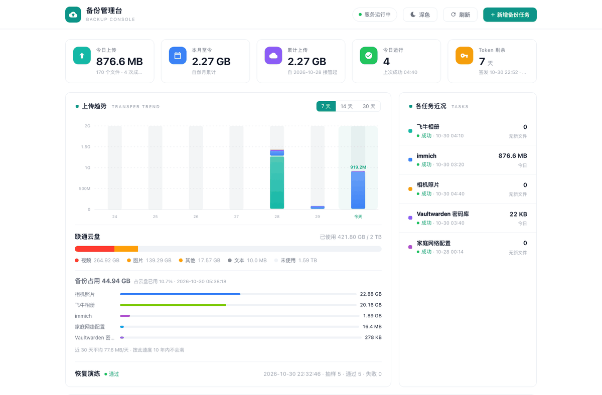
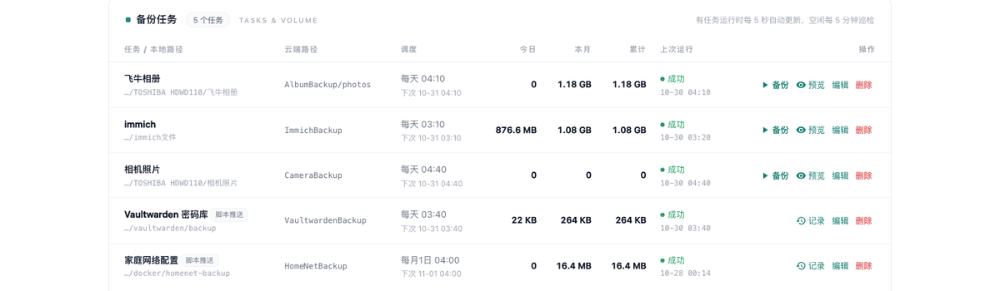
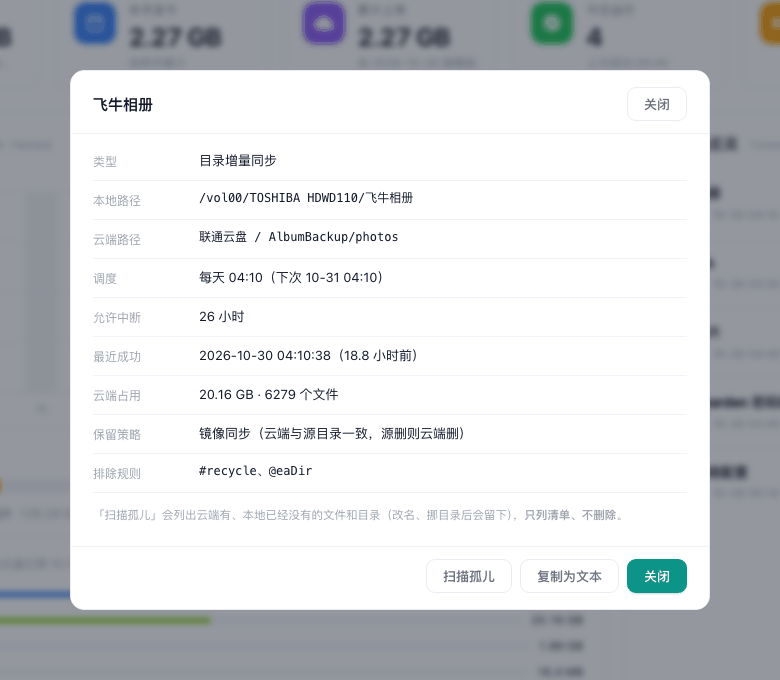

# tpbackup

联通云盘（沃盘）备份管理台。把「扫描本地目录 → 比对云端 → 增量上传 → 校验 → 记日志」收进一个容器，网页管理，定时调度，上传后逐文件复核。

为 NAS 上的照片、媒体库、文档这类「只增不改」的目录设计，也支持先在宿主机打包快照、再交给它上传的推送模式。



## 装起来

需要三样东西：一台装了 Docker 的机器（NAS 或 Linux 都行）、一个联通云盘账号、一个能拿到云盘令牌的浏览器。

镜像已经发布在 GitHub 容器仓库，**装的过程不需要 clone 代码，也不需要本地编译**。

### 最快：一条命令

```bash
curl -fsSL https://raw.githubusercontent.com/mingyangbest/tpbackup/main/install.sh | bash
```

脚本会做完这些：检查 Docker、建一个 `tpbackup/` 目录、生成 compose 和 `.env`（密码随机）、拉镜像、起容器、等它变成 healthy，最后把访问地址和密码打印出来。跑完照屏幕上的三行接着做就行。

不想 `curl | bash` 的话，先下载看一遍再执行：

```bash
curl -fsSLO https://raw.githubusercontent.com/mingyangbest/tpbackup/main/install.sh
less install.sh          # 看完了再跑
bash install.sh
```

指定位置和端口，用环境变量：

```bash
TPBACKUP_DIR=/vol1/docker/tpbackup TPBACKUP_PORT=9000 bash install.sh
```

重复运行不会重置密码、不会动 `data/`，升级时也可以直接重跑。

### 次快：compose 文件

想自己控制每一步，或者要把 compose 纳进已有编排，就用这个：

```bash
mkdir -p tpbackup && cd tpbackup

curl -fsSLO https://raw.githubusercontent.com/mingyangbest/tpbackup/main/docker-compose.yml
curl -fsSL https://raw.githubusercontent.com/mingyangbest/tpbackup/main/.env.example -o .env

# 改 .env 两处：TP_PASS（登录密码）、BACKUP_DIR（要备份的目录）
vi .env

docker compose up -d
```

`docker-compose.yml` 本身有默认值，不改也能起：端口 8088、密码 `tpbackup`、备份目录是当前目录下的 `library/`。**默认密码只够让你先看到界面，用起来之前一定要改。**

### 想改代码、或不想用预构建镜像

```bash
git clone https://github.com/mingyangbest/tpbackup.git
cd tpbackup
docker compose -f docker-compose.build.yml up -d --build
```

首次构建几分钟。这条路的配置文件同样是 `docker-compose.yml`（build 版只是把「拉镜像」换成「本地构建」，其余继承），端口密码目录的改法一样。

### 不用命令行：NAS 图形界面

群晖的 Container Manager、飞牛的 Docker 应用都有「项目 / Compose」入口，可以直接把 `docker-compose.yml` 的内容粘进去新建项目，效果和命令行一样。改端口、密码、目录就在粘进去的那段文本里改，或者在该项目的环境变量里加 `TP_PASS`、`BACKUP_DIR`。

### 装完第一步：放令牌

容器自己不走登录流程，第一次的令牌要在外部拿。打开 <https://alistgo.com/tool/wopan/token.html>，支持账号密码、短信验证码、APP 扫码三种方式。

两个必须注意的点：

1. **一定要拿到 `refresh_token`**。只有 `access_token` 的话 7 天后凭证就断了，系统没法自动续期。APP 扫码有时不返回刷新令牌，工具会明确提示，遇到就换短信验证码方式。
2. 取完令牌后**别再去网页端登录联通云盘**，网页端会把工具这条登录踢下线。手机端 APP 不受影响。

拿到之后，在面板右上角「Token 剩余」卡片里点 **粘贴令牌**，填两个字段，点「保存并验证」。保存前会拿这对令牌真连一次云端（列一次云盘根目录），**通过才落盘**；验不过什么都不改，现有凭证不会丢。成功即生效，不用重启容器。

<details>
<summary>也可以用 SSH 直接写文件（排错或自动化时用）</summary>

```bash
cd tpbackup
sudo mkdir -p data/state
sudo tee data/state/token.json >/dev/null <<'EOF'
{
  "access_token": "<你的 access_token>",
  "refresh_token": "<你的 refresh_token>",
  "updated": "2026-01-01 00:00:00"
}
EOF
sudo chmod 600 data/state/token.json
sudo docker compose restart
```

`updated` 只用于计算剩余天数，填当前时间即可，续期后系统自己更新。
</details>

确认生效：

```bash
curl -u admin:<密码> http://127.0.0.1:8088/api/token
# 返回里有 remain_days ≈ 7 且 has_refresh: true 即可
```

### 装完第二步：建第一个任务

浏览器打开 `http://<机器IP>:8088`，登录后点「新增备份任务」，填三样：名称、源目录、云端路径。源目录就是容器里的 `/data`（对应你挂进来的那个宿主机目录），界面上可以直接浏览点选。

保存后**先点「试运行」**，它会列出待传清单但一个字节都不传；清单是对的，再点「立即备份」。

想定时跑，在任务的 cron 字段填表达式（`10 4 * * *` = 每天 04:10），留空则只能手动触发。

### 装不上？先看这三条

| 现象 | 原因 |
|---|---|
| `docker compose pull` 报 `denied` / `unauthorized` | 镜像包没公开。改用上面的「从源码构建」，或去仓库 Packages 页面把包可见性改成 public |
| 报 `port is already allocated` | 8088 被占了。改 `.env` 里 `TP_PORT`，或 `TPBACKUP_PORT=9000 bash install.sh` |
| 面板里浏览不到目录，或建任务提示路径不在允许范围 | 容器里只挂了 `BACKUP_DIR` 到 `/data`。要备份别的目录，改 `BACKUP_DIR` 后 `docker compose up -d`；要同时挂多个目录，照 `docker-compose.build.yml` 的写法往 `volumes` 里加，并让 `TP_ALLOWED_ROOTS` 覆盖它们 |

## 升级

```bash
cd tpbackup
docker compose pull
docker compose up -d
```

任务配置、令牌、日志都在 `./data`，升级不动它。想钉住某个版本，在 `.env` 里写 `IMAGE_REF=ghcr.io/mingyangbest/tpbackup:0.2.2`。

版本与更新记录：[Releases](https://github.com/mingyangbest/tpbackup/releases) · [CHANGELOG.md](CHANGELOG.md)

## 功能特性

- **增量同步**：按「文件名 + 体积」比对云端，只传新文件和变过的文件；文件名大小写不敏感比对（联通云盘特性，避免 iOS 导出的 `FullSizeRender.heic` 与 `FULLSIZERENDER.HEIC` 互相覆盖）
- **两级复核**：上传后先比体积，云端返回了 SHA256 且文件不超过 64MB 时再比内容哈希——「云盘说收到了」升级成「内容确认一致」
- **断点续传**：16MB 以上的文件按 8MB 分片上传，传完的片记在本机的会话表里，断了重跑从断点接上，已传的片不重传。会话 24 小时有效，文件改动、换目标目录、换令牌都会作废重开。`TP_RESUME=0` 可整体关掉
- **试运行**：只扫描比对列出待传清单，一个字节都不传。新任务先试运行再真跑
- **定时调度**：每个任务一条 cron 表达式，改完即生效，不用重启
- **推送模式**：密码库导出、虚拟机镜像这类需要先在宿主机打包/加密的任务，由宿主机脚本打包后调 API 上传，支持云端保留 N 份滚动清理
- **恢复演练**：每月随机抽样，从云端真下载回来——先比体积、再比 SHA256；结果进面板，失败或超 45 天未演练会被巡检抓出来
- **孤儿扫描**：云端有、本地已经没有的文件和目录（改名、挪目录留下的），列成清单给你看，**只列不删**；另有「含已排除」视图，用来查被排除规则藏起来、却还占着配额的云端残留
- **界面换令牌**：令牌过期不用 SSH，Token 卡片里粘贴即可——保存前先真连一次云端验证，验不过不动现有凭证
- **令牌自管理**：云盘令牌有效期 7 天，剩余不足 2 天自动续期；可选与 OpenList 共用同一凭证（本应用作为唯一刷新者）
- **心跳外报**：每次运行结束把结果推给 Uptime Kuma 的 push 监控项，失败时带上原因，告警策略交给 Kuma
- **空文件的边界**：0 字节文件云盘不收，dir 扫描会单独计数并写进日志（不并进「跳过」），push 则按单文件失败处理、其余文件照传
- 单文件前端，零外部依赖，内联图标离线可用，明暗双主题



<sub>任务表 —— 本地 / 云端路径、调度、传输量、上次运行；点任务名可看详情</sub>



<sub>任务详情 —— 允许中断、最近成功、云端占用、保留策略，以及「扫描孤儿」入口</sub>

## 安全边界

- **dir 模式不加密**：照片、媒体库这类目录是**原样上传**的，云端能看到文件内容和文件名。放密码库、密钥、证件这类敏感数据请走 **push 模式**——先在宿主机打包并加密（`openssl` / `age` 都行），再交给本应用上传，云端只有密文。
- Web 端是**单账号 Basic Auth**，只建议内网使用。要暴露到公网，请放在 HTTPS 反向代理之后，别把 8088 裸奔在上面。

## 配置参考

compose 里的这几个变量从 `.env` 读，不起作用时先看 `.env` 在不在 compose 同目录：

| compose 变量 | 默认 | 说明 |
|---|---|---|
| `TP_PORT` | 8088 | 宿主机端口 |
| `BACKUP_DIR` | `./library` | 要备份的宿主机目录，挂到容器内 `/data` |
| `TP_PASS` / `TP_USER` | tpbackup / admin | Web 与 API 登录凭据。**默认密码务必修改** |
| `TP_ALLOWED_ROOTS` | /data | 界面能浏览、能建任务的范围（容器内路径） |
| `IMAGE_REF` | ghcr.io/…:latest | 镜像地址，用来钉版本或换自建镜像 |

容器自身的环境变量：

| 环境变量 | 默认 | 说明 |
|---|---|---|
| `TP_DATA` | /app/data | 配置、令牌、日志、SQLite 的存放位置 |
| `TP_RESUME` | 1 | 是否启用大文件断点续传。设 `0` 关闭，之后每个文件都是一次全新上传（与 v0.2.1 行为一致） |
| `TP_RESUME_MIN_SIZE` | 16777216 | 多大的文件才走断点续传（字节）。默认 16MiB；再小的文件本来就只有一两片，存会话只是多一次写盘 |
| `TP_PROTECT_FILES` | 空 | 推送任务滚动清理时永不删除的云端文件名，逗号分隔（如 `README.txt`） |
| `TP_OPENLIST_DB` | 空 | OpenList 的 data.db 路径，填了则首次启动从库中导入令牌 |
| `TP_SYNC_OPENLIST` | 0 | 刷新令牌后是否回写 OpenList 库 |
| `TP_SEED` | 0 | 首次启动是否导入示例任务（先改 `app/main.py` 里 `seed_tasks()` 的路径再开） |
| `TP_FILE_UID` / `TP_FILE_GID` | 1000 / 1000 | 恢复出来的文件属主 |
| `TP_CONTAINER` | tpbackup | 冒烟脚本（tools/smoke_test.py）操作的容器名 |

安全提醒：本服务能读写挂载的文件、持有云盘凭证。Basic Auth 未加密、无速率限制，**只建议在内网使用**；需要公网访问请套反向代理 + HTTPS，并使用强密码。

## 使用

### 目录同步（dir）与推送（push）

| | dir | push |
|---|---|---|
| 谁打包 | 不需要 | 宿主机脚本 |
| 谁调度 | 本应用（任务的 cron 字段） | 宿主机 cron |
| 界面操作 | 立即备份 / 试运行 | 无（调度在宿主机） |
| 适用 | 照片、媒体库、文档这类目录 | 需要先打快照/加密的任务 |

dir 任务在界面上「新增备份任务」即可：名称、源目录、云端路径（不存在自动建）、cron（留空只手动）、排除项（每行一个，支持通配符；**目录名和文件名都适用**，例如 `#recycle`、`Thumbs.db`、`*.tmp`）。保存即生效。

push 任务先在界面上建同名任务（或让脚本首次调用时自动创建），然后在宿主机：

```bash
# 上传，云端保留最近 14 份
python3 push.py --task "Vaultwarden 密码库" --cloud VaultwardenBackup \
    --keep 14 --pattern 'vaultwarden-*.tar.gz' -- /path/包.tar.gz

# 查云端文件 / 下载回来（巡检用）
python3 fetch.py --stat --cloud HomeNetBackup --name a.enc
python3 fetch.py --out /tmp/a.enc --cloud HomeNetBackup --name a.enc

# 查某任务最近一次真实运行状态（预览不算）
python3 taskstat.py --task immich
```

`--keep` 按文件名字典序保留最新 N 份并删除其余（时间戳命名天然有序）；`--dry-run` 只校验不传输。

这两个脚本要在**宿主机**跑（连 8088），需要凭据文件：

```bash
cp api.conf.example api.conf
# 编辑 api.conf：账号密码与 compose 里的 TP_USER / TP_PASS 保持一致
```

### 大文件断点续传

云盘的分片上传有会话：同一个 `uniqueId` 的片，中间断了还能接着传。本应用把这个会话记在本地（`TP_DATA` 下的 SQLite，表名 `upload_sessions`），所以**进程重启、容器重建都不影响续传**。

- 只有 16MiB 以上的文件走这条路（阈值是 `TP_RESUME_MIN_SIZE`）。小文件本来就只有一两片，存会话反而多一次写盘。
- 每传完一片记一次进度，每 32 片落一次盘（8MiB × 32 = 256MiB，崩了最多重传这么多）。
- 复核通过才删会话。复核明确判负（体积不对、哈希不符）也删，下次从头来；只有「列目录失败、根本没拿到校验结果」才留着，下次直接续，不用重传。
- 会话 24 小时后自动作废（懒清理，不用定时器）。文件体积或 mtime 变了、目标目录变了、令牌换过了，也都会判废重开——最坏多传一遍，不赌服务端还认旧会话。
- 想彻底关掉：`TP_RESUME=0`。

```bash
# 看当前攒了多少条会话（正常情况下跑到最后会自己删干净）
docker exec tpbackup python3 -c \
  "from app.store import SessionStore; print(SessionStore('/app/data/tpbackup.db').count())"
```

### 恢复

界面上**没有放取回入口**（按需再开），需要取回时直接调接口，落到 `TP_ALLOWED_ROOTS` 内的指定目录：

```bash
# 整目录（path 留空表示任务云端根目录）
curl -u admin:<密码> -X POST http://127.0.0.1:8088/api/restore \
  -H 'Content-Type: application/json' \
  -d '{"task_id":1,"path":"","dest":"/data/恢复"}'

# 单文件
curl -u admin:<密码> -X POST http://127.0.0.1:8088/api/restore \
  -H 'Content-Type: application/json' \
  -d '{"task_id":4,"path":"vaultwarden-20261030T034001.tar.gz","dest":"/data/恢复"}'
```

`dest` 要落在白名单里。用默认 compose 时白名单是 `/data`，所以这里写 `/data/...`，对应宿主机 `BACKUP_DIR/恢复`。

`tools/drill.py` 做月度演练：随机抽样真实下载回来，先比体积、再比 SHA256——界面上的「成功」只证明传得上去，演练证明取得回来。

### 与 OpenList 共用令牌

两个组件都持有云盘凭证时，必须只有一个刷新者，否则会互相覆盖把好凭证换成旧的。推荐分工：**tpbackup 是唯一权威刷新者**（提前 2 天续期），OpenList 只做浏览。

compose 里设 `TP_OPENLIST_DB` 和 `TP_SYNC_OPENLIST=1`，宿主机再跑 `tools/openlist_sync.py`（每 10 分钟一次的 crontab）：令牌变化时写回 OpenList 库并重启它重载（OpenList 把存储配置读在内存里，改库不生效，重启是唯一可靠方式；只在真变化时重启，约 5~7 天一次）。脚本顶部路径可用环境变量覆盖。

顺带一提：OpenList 的 WoPan 存储里 `family_id` 必须留空，填了真实家庭 ID 反而列出空的家庭空间。

## 数据与备份

```
tpbackup/
├── docker-compose.yml
├── .env                 # 端口、密码、备份目录
├── data/                # 容器里的 /app/data
│   ├── tpbackup.db      # 任务定义 + 运行历史（SQLite）
│   ├── state/token.json # 云盘令牌（600 权限）
│   └── logs/<任务名>.log # 每个任务的完整运行日志
└── library/             # 默认的备份源目录（被挂到容器内 /data）
```

`data/` 建议纳入你自己的备份范围——里面有任务配置和令牌，丢了要重新配置和授权。

## 故障排查

```bash
docker logs -f tpbackup                           # 服务日志
docker exec tpbackup ls /app/data/logs            # 任务日志
curl -u admin:<密码> http://127.0.0.1:8088/api/token    # 令牌状态
python3 tools/smoke_test.py                       # 11 项关键接口冒烟
```

| 现象 | 原因 |
|---|---|
| 报 `token-refresh` | refresh_token 失效：当初只填了 access_token，或网页端登录把凭证踢下线了。重新取令牌 |
| 报 `cloud-unreachable` | 网络不通或 DNS 异常 |
| 上传大量失败 | 并发过高触发频控，把任务的 workers 调到 2 |
| 试运行列表为空 | 云端已存在同名同大小文件，属正常 |
| 目录浏览看不到文件 | 源目录不在 `TP_ALLOWED_ROOTS` 内，或 volumes 挂错了 |
| 宿主机脚本报 401 | `api.conf` 里的密码和 compose 里的不一致 |
| 界面一直显示「运行中」 | 容器重启留下的僵尸记录，再重启一次会自动清扫（启动时标记为 interrupted） |

## 项目结构

```
tpbackup/
├── Dockerfile                 python:3.12-slim + curl（分片上传用）
├── docker-compose.yml         开箱即用：拉预构建镜像
├── docker-compose.build.yml   从源码构建
├── .env.example               端口、密码、备份目录模板
├── install.sh                 一键安装脚本
├── requirements.txt           fastapi / uvicorn / apscheduler / cryptography
├── api.conf.example           宿主机脚本的 API 凭据模板
├── app/
│   ├── main.py                FastAPI 路由与鉴权
│   ├── engine.py              联通云盘协议实现（分片、加密、重试、复核）
│   ├── store.py               令牌落盘续期 + SQLite
│   ├── runner.py              任务执行与实时进度
│   ├── scheduler.py           cron 调度 + 每日维护
│   ├── paths.py               本地路径白名单（realpath + 路径段比较）
│   ├── orphans.py             孤儿扫描（只读）
│   ├── notify.py              Uptime Kuma 心跳
│   └── static/index.html      前端（单文件）
├── push.py / fetch.py / taskstat.py   宿主机脚本
└── tools/                     巡检与演练
    ├── smoke_test.py          关键接口冒烟（含路径穿越回归用例）
    ├── verify_e2e.py          真实上传链路端到端测试
    ├── drill.py               恢复演练
    └── openlist_sync.py       令牌同步给 OpenList
```

引擎里有几处针对联通云盘特性的处理，改代码前先看 `app/engine.py` 头部注释：强制 IPv4（该域名 AAAA 记录会挂死）、显式禁用代理、分片上传用 curl 发 multipart（比 urllib 手拼稳定）、文件名大小写不敏感建索引、频控 9999 退避重试且只有凭证错误才刷 token。

## 开发

```bash
python -m pip install -r requirements-dev.txt
python -m pyflakes app/ tools/ tests/ *.py
python -m pytest -q
python tools/smoke_test.py        # 需要服务已在运行
```

提交 PR 前 CI 会跑语法编译、pyflakes、单测和 Docker 构建；打 `v*` 标签时另外构建 amd64/arm64 双架构镜像推到 ghcr。

## 免责声明

本项目通过逆向工程实现联通云盘的非公开上传接口，**仅供个人学习与研究使用**：

- 本项目与联通公司及其云盘产品无任何关联，亦非官方工具
- 直接调用非公开接口可能违反服务条款，存在账号被风控、限速甚至封禁的风险，请自行评估
- 请仅备份你拥有权利备份的内容，遵守所在地的法律法规
- 因使用本项目造成的任何直接或间接损失，作者不承担责任

如权利方认为本项目侵犯其合法权益，请提 issue 联系，会及时处理。

## 许可证

[MIT](LICENSE)
